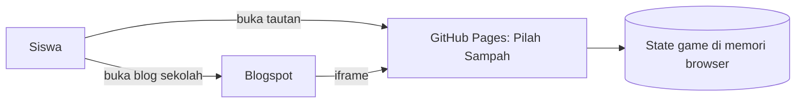
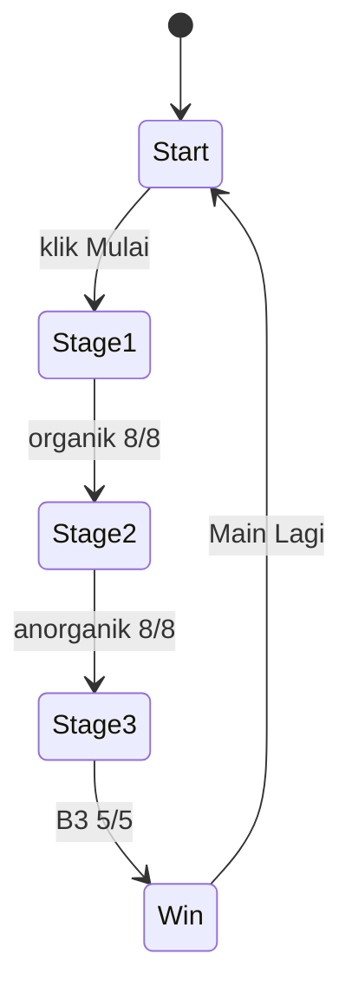

# PRD – Pilah Sampah

**Jenis dokumen:** Product Requirements Document (MVP) **Platform:** Web game statis (HTML + Tailwind + Vanilla JS) **Publikasi:** GitHub Pages (utama) dan embed Blogspot/Blogger (iframe) **Status:** Draft 1.0, siap handoff ke developer

---

## 1. EXECUTIVE SUMMARY

### 1.1 Ringkasan Proyek

"Pilah Sampah" adalah game edukasi berbasis browser yang mengajarkan siswa memilah sampah **organik, anorganik, dan B3** (Bahan Berbahaya dan Beracun). Latar game adalah halaman sekolah yang kotor dan penuh sampah. Siswa membersihkannya dengan mengklik/tap sampah. Setiap kategori punya satu tong sampah yang muncul bergantian secara berurutan. Setelah ketiga tong penuh, halaman sekolah berubah menjadi bersih.

**Cakupan MVP:** 21 sampah (8 organik, 8 anorganik, 5 B3), 3 tahap berurutan, umpan balik benar/salah, layar pembuka, layar selesai, dan tombol main ulang. Game berjalan penuh di sisi klien tanpa backend dan tanpa penyimpanan data.

### 1.2 Latar Belakang & Masalah

- **Masalah:** Banyak siswa belum terbiasa membedakan jenis sampah, terutama B3 yang sering tercampur dengan sampah biasa (baterai, lampu, kaleng cat).
- **Kondisi saat ini:** Materi pemilahan sampah umumnya disampaikan lewat teks atau poster yang pasif.
- **Dampak:** Praktik pemilahan di sekolah dan rumah tidak konsisten, dan risiko pencemaran dari B3 diremehkan.
- **Mengapa solusi diperlukan:** Game interaktif dengan umpan balik langsung lebih menarik dan mudah diulang oleh guru di kelas.
- **Alasan arsitektur:** Game tidak perlu menyimpan data, sehingga cukup **static hosting** (GitHub Pages). Biayanya nol, perawatannya minim, dan bisa disematkan di Blogspot sekolah lewat iframe. Google Apps Script dan Google Sheets **tidak dipakai di MVP** (lihat bagian 2).

### 1.3 Tujuan & Target Audiens

| Kategori | Uraian |
| --- | --- |
| Tujuan produk | Menyediakan media belajar pemilahan sampah yang gratis, ringan, dan mudah dibagikan lewat tautan atau embed |
| Tujuan pengguna | Memahami perbedaan sampah organik, anorganik, dan B3 melalui bermain |
| Target pengguna | Siswa SD kelas atas sampai SMP (asumsi), guru sebagai fasilitator |
| KPI (indikatif) | Game bisa diselesaikan dalam 3–5 menit; ≥ 90% sesi uji bisa menyelesaikan 3 tahap tanpa bantuan; waktu muat awal < 3 detik pada jaringan 4G |

---

## 2. SYSTEM ARCHITECTURE & DATA FLOW

### 2.1 Gambaran Arsitektur

| Komponen | Peran di MVP |
| --- | --- |
| GitHub Pages | Hosting game (index.html, JS, CSS, aset gambar/SVG, audio) |
| Blogspot/Blogger | Menyematkan game lewat `<iframe>` yang menunjuk ke URL GitHub Pages |
| GAS Web App | **Tidak dipakai** di MVP |
| Google Sheets | **Tidak dipakai** di MVP |
| GAS HTML Service | **Tidak dipakai** di MVP (admin panel tidak diperlukan) |



### 2.2 Data Flow

Tidak ada alur `Frontend → GAS → Sheets`. Alur data seluruhnya ada di dalam browser:

`Siswa → klik sampah → Game Engine (validasi kategori) → update state → render UI/animasi`

- Data sampah (nama, kategori, gambar, posisi) disimpan sebagai **konstanta JSON** di dalam kode (`items.js`).
- State sesi (tahap aktif, jumlah terisi per tong, jumlah salah klik) hanya hidup di memori dan hilang saat halaman dimuat ulang.
- Tidak ada `doGet`/`doPost`, tidak ada payload JSON jaringan, dan tidak ada CORS.

### 2.3 CORS

Tidak relevan di MVP karena tidak ada request lintas-origin ke API. Catatan untuk embed Blogspot: iframe tidak terkena masalah CORS. Yang perlu diperhatikan adalah header `X-Frame-Options`/CSP. GitHub Pages secara default mengizinkan embed iframe, jadi jangan menambahkan header yang melarangnya. Jika fase 2 menambahkan GAS, strategi CORS akan dirancang pada saat itu (request sederhana atau proxy).

### 2.4 Database Google Sheets

**Tidak ada database di MVP.** Struktur data statis yang dipakai game:

**Tabel konfigurasi tahap (konstanta kode)**

| Field | Tipe | Wajib | Contoh |
| --- | --- | --- | --- |
| stageId | number (unik) | Ya | 1 |
| category | enum: organik, anorganik, b3 | Ya | "organik" |
| target | number | Ya | 8 |
| binColor | string (hex) | Ya | "#16A34A" |
| binLabel | string | Ya | "ORGANIK" |

**Tabel item sampah (konstanta kode)**

| Field | Tipe | Wajib | Contoh |
| --- | --- | --- | --- |
| itemId | string (unik) | Ya | "org-01" |
| name | string | Ya | "Kulit pisang" |
| category | enum (relasi ke stage) | Ya | "organik" |
| sprite | path gambar/SVG | Ya | "assets/org-01.svg" |
| x, y | number (persen terhadap stage) | Ya | 24, 68 |
| hint | string | Tidak | "Bisa terurai menjadi kompos" |

**Daftar sampah (usulan awal, dapat diubah)**

| Kategori | Jumlah | Item |
| --- | --- | --- |
| Organik | 8 | Kulit pisang, daun kering, sisa nasi, kulit jeruk, ranting kecil, sisa sayur, bonggol apel, cangkang telur |
| Anorganik | 8 | Botol plastik, kaleng minuman, kantong plastik, gelas plastik, botol kaca, bungkus snack, kertas/kardus bekas, styrofoam |
| B3 | 5 | Baterai bekas, bohlam/lampu bekas, kaleng cat, botol obat kedaluwarsa, kaleng semprot obat nyamuk |

### 2.5 API Contract

Tidak ada API di MVP. Kontrak yang berlaku adalah **kontrak internal modul JavaScript**:

| Modul | Fungsi | Input | Output |
| --- | --- | --- | --- |
| `GameState` | `init()`, `getStage()`, `addToBin(itemId)`, `reset()` | itemId | state terbaru |
| `GameEngine` | `handleItemClick(itemId)` | itemId | `{result: "correct"\|"wrong", stageComplete: bool, gameComplete: bool}` |
| `UI` | `renderStage()`, `animateToBin()`, `showFeedback()`, `showWin()` | state | efek visual |

---

## 3. USER FEATURES & FUNCTIONAL REQUIREMENTS

### 3.1 Panel Admin (GAS HTML Service)

Tidak ada di MVP. Konten (daftar sampah) diubah langsung di `items.js` oleh developer/guru yang mengelola repository.

### 3.2 Web Publik (GitHub Pages)

**Alur layar:**

1. **Layar Pembuka:** judul "Pilah Sampah", latar halaman sekolah kotor, petunjuk singkat, tombol **Mulai**.
2. **Tahap 1 – Organik:** tong **hijau** berlabel "ORGANIK" terbuka. Penghitung 0/8. Siswa mengklik sampah organik hingga 8/8. Tong berubah **penuh/tertutup**.
3. **Tahap 2 – Anorganik:** tong hijau hilang, muncul tong **kuning** terbuka berlabel "ANORGANIK". Penghitung 0/8. Setelah 8/8, tong penuh.
4. **Tahap 3 – B3:** tong kuning hilang, muncul tong **merah** terbuka berlabel "B3" (tampilan sama seperti awal). Penghitung 0/5. Setelah 5/5, tong penuh.
5. **Layar Selesai:** latar bertransisi menjadi **halaman sekolah bersih**. Ditampilkan pesan apresiasi, ringkasan edukatif singkat per kategori, dan tombol **Main Lagi**.

**Aturan interaksi:**

- Semua 21 sampah tampak tersebar di halaman sejak awal untuk menciptakan kesan kotor.
- Pada tiap tahap, hanya sampah **kategori tahap itu** yang dianggap benar. Sampah kategori lain tetap di tempat.
- Klik sampah benar → sampah terbang ke tong, penghitung bertambah.
- Klik sampah salah → sampah bergoyang, muncul pesan edukatif (mis. "Ini sampah anorganik, belum waktunya ya!"). Sampah tidak berpindah.
- Responsif: dapat dimainkan di HP (tap), tablet, dan desktop (klik).

### 3.3 Widget Konten (Blogspot)

- Embed lewat iframe: `<iframe src="https://USERNAME.github.io/pilah-sampah/" width="100%" height="600" style="border:0" allowfullscreen loading="lazy"></iframe>`.
- Stage game memakai rasio 16:9 dan skala otomatis mengikuti lebar iframe. Disarankan menyediakan tombol "Layar Penuh".
- Loading state: tampilan "Memuat game…" dengan bilah progres aset.
- Error/fallback: jika aset gagal dimuat, tampil pesan dan tautan langsung ke GitHub Pages.
- Batasan Blogger: file game tidak di-host di Blogger. Kode game hanya di GitHub Pages, sehingga tidak ada script pihak ketiga yang disuntikkan ke templat blog.

### 3.4 User Stories

**Siswa**

- Sebagai siswa, saya ingin mengklik sampah dan melihatnya masuk ke tong, sehingga saya paham sampah itu termasuk kategori apa.
- Sebagai siswa, saya ingin mendapat penjelasan singkat ketika salah, sehingga saya belajar dari kesalahan.
- Sebagai siswa, saya ingin melihat halaman sekolah menjadi bersih di akhir, sehingga saya merasa berhasil.
- Sebagai siswa, saya ingin bisa main lagi, sehingga saya bisa berlatih ulang.

**Guru**

- Sebagai guru, saya ingin membagikan satu tautan atau menyematkan game di blog sekolah, sehingga siswa mudah mengaksesnya.
- Sebagai guru, saya ingin game bisa dimainkan di HP siswa, sehingga tidak perlu perangkat khusus.

**Pengelola konten (developer/guru teknis)**

- Sebagai pengelola, saya ingin mengubah daftar sampah lewat satu file konfigurasi, sehingga materi mudah diperbarui.

### 3.5 Acceptance Criteria

- **Given** game dimulai **When** tahap organik aktif **Then** hanya tong hijau berlabel "ORGANIK" yang tampil terbuka dengan penghitung 0/8.
- **Given** tahap organik aktif **When** siswa mengklik sampah organik **Then** sampah terbang ke tong dan penghitung naik 1.
- **Given** tahap organik aktif **When** siswa mengklik sampah anorganik atau B3 **Then** sampah bergoyang, pesan edukatif muncul, dan penghitung tidak berubah.
- **Given** penghitung mencapai 8/8 **When** animasi penuh selesai **Then** tong hijau digantikan tong kuning terbuka dengan penghitung 0/8.
- **Given** tong kuning 8/8 **When** animasi selesai **Then** tampil tong merah terbuka dengan penghitung 0/5.
- **Given** tong merah 5/5 **When** animasi selesai **Then** latar berganti ke halaman bersih dan layar selesai tampil.
- **Given** layar selesai **When** siswa menekan Main Lagi **Then** semua state direset ke kondisi awal (21 sampah muncul kembali, tahap 1).

### 3.6 Functional Requirements

| ID | Requirement | Priority | Actor | Acceptance Criteria | Dependency |
| --- | --- | --- | --- | --- | --- |
| FR-001 | Menampilkan layar pembuka dengan judul, petunjuk, dan tombol Mulai | Must | Siswa | Tombol Mulai memulai tahap 1 | – |
| FR-002 | Menampilkan latar halaman sekolah kotor dengan 21 sampah tersebar (8 org, 8 anorg, 5 B3) | Must | Siswa | Jumlah per kategori tepat 8/8/5 | Aset gambar |
| FR-003 | Tahap 1: tong hijau terbuka berlabel ORGANIK, target 8 | Must | Siswa | Sesuai AC 3.5 | FR-002 |
| FR-004 | Tahap 2: tong kuning terbuka berlabel ANORGANIK, target 8 | Must | Siswa | Sesuai AC 3.5 | FR-003 |
| FR-005 | Tahap 3: tong merah terbuka berlabel B3, target 5 | Must | Siswa | Sesuai AC 3.5 | FR-004 |
| FR-006 | Klik/tap sampah benar memindahkan sampah ke tong secara otomatis dengan animasi | Must | Siswa | Penghitung bertambah 1 | FR-002 |
| FR-007 | Klik sampah salah memicu animasi goyang dan pesan edukatif tanpa mengubah progres | Must | Siswa | Progres tidak berubah | FR-006 |
| FR-008 | Tong menampilkan kondisi penuh (tutup/label PENUH) saat mencapai target | Must | Siswa | Tampil sebelum pergantian tong | FR-003–005 |
| FR-009 | Transisi otomatis antar-tahap setelah tong penuh | Must | Sistem | Tidak perlu aksi tambahan siswa | FR-008 |
| FR-010 | Setelah tahap 3 selesai, latar berganti ke halaman sekolah bersih | Must | Sistem | Transisi cross-fade ≤ 2 detik | FR-005 |
| FR-011 | Layar selesai dengan pesan apresiasi dan ringkasan edukasi | Must | Siswa | Menampilkan 3 kategori | FR-010 |
| FR-012 | Tombol Main Lagi mereset game penuh | Must | Siswa | State kembali ke awal | FR-011 |
| FR-013 | Tata letak responsif dan dapat dimainkan di HP/tablet/desktop | Must | Siswa | Area sentuh ≥ 44×44 px | – |
| FR-014 | Dapat disematkan via iframe di Blogspot dan menskalakan diri | Must | Guru | Tidak ada scroll horizontal di iframe | GitHub Pages |
| FR-015 | Indikator tahap (1/3, 2/3, 3/3) dan penghitung per tong | Should | Siswa | Selalu terlihat | – |
| FR-016 | Efek suara (klik benar, salah, tong penuh, selesai) dengan tombol mute | Should | Siswa | Mute tersimpan selama sesi | – |
| FR-017 | Konten sampah dikonfigurasi dari satu file `items.js` | Should | Pengelola | Mengubah file mengubah isi game tanpa mengubah logika | – |
| FR-018 | Tombol layar penuh | Could | Siswa | Berfungsi di browser yang mendukung | – |
| FR-019 | Ringkasan jumlah salah klik di layar selesai (tidak disimpan) | Could | Siswa | Angka tampil di layar akhir | FR-007 |
| FR-020 | Penyimpanan skor, peringkat, atau dashboard guru | Won't (MVP) | – | Ditunda ke Fase 2/3 | GAS + Sheets |

---

## 4. NON-FUNCTIONAL REQUIREMENTS

### 4.1 Security

- Tidak ada data pribadi, login, atau backend, sehingga permukaan serangan sangat kecil.
- Jangan memuat script dari domain yang tidak perlu. Gunakan versi library yang dipin bila memakai CDN (mis. Tailwind), atau lebih baik build CSS statis.
- Semua teks dinamis dirender dengan `textContent`, bukan `innerHTML`.
- Jangan menyimpan secret apa pun di repository.
- Bila embed di Blogspot, hanya satu iframe ke domain GitHub Pages milik sekolah/pengelola.

### 4.2 Keterbatasan Google Apps Script

Tidak relevan di MVP. Jika Fase 2 menambahkan GAS, perlu dipertimbangkan batas waktu eksekusi, kuota harian, eksekusi bersamaan, dan latensi Spreadsheet. Angka kuota dapat berubah menurut akun dan kebijakan Google, jadi verifikasi ke dokumentasi resmi saat itu.

### 4.3 Performance

- Total aset awal ≤ 3 MB (target), gunakan SVG atau WebP yang dikompresi.
- Preload aset kritis, lazy-load audio.
- Animasi memakai CSS transform/opacity agar halus (target 60 fps pada HP kelas menengah).
- Waktu muat awal < 3 detik pada 4G.

### 4.4 Reliability & Accessibility

- Game tidak bergantung pada jaringan setelah aset termuat.
- Fallback jika audio gagal dimuat: game tetap berjalan tanpa suara.
- Kontras warna memadai, label tong memakai teks (tidak hanya warna) agar ramah buta warna.
- Dukungan keyboard dasar (Tab + Enter pada sampah) sebagai peningkatan.
- Browser target: dua versi terakhir Chrome, Edge, Firefox, Safari, serta Chrome Android dan Safari iOS.

### 4.5 Scalability

Static hosting sangat memadai untuk lalu lintas kelas/sekolah. Migrasi hanya diperlukan jika muncul kebutuhan penyimpanan skor lintas pengguna (lihat Roadmap).

---

## 5. INTEGRATION & DEPLOYMENT PLAN

### 5.1 Backend GAS

Tidak dibuat di MVP.

### 5.2 GitHub Pages

**Struktur repository (usulan):**

```
pilah-sampah/
├─ index.html
├─ css/style.css
├─ js/
│  ├─ items.js        (data 21 sampah + konfigurasi tahap)
│  ├─ state.js        (GameState)
│  ├─ engine.js       (aturan permainan)
│  └─ ui.js           (render & animasi)
├─ assets/
│  ├─ bg-kotor.svg
│  ├─ bg-bersih.svg
│  ├─ bins/ (hijau, kuning, merah: terbuka & penuh)
│  ├─ items/ (21 sprite)
│  └─ audio/
└─ README.md
```

**Langkah:** buat repository → push kode → Settings → Pages → pilih branch `main` (root) → akses di `https://USERNAME.github.io/pilah-sampah/`. Custom domain bersifat opsional. Tidak ada build step bila memakai Vanilla JS.

### 5.3 Blogspot

1. Buat posting/halaman baru, ganti ke mode **HTML**.
2. Tempel kode iframe yang menunjuk ke URL GitHub Pages.
3. Pratinjau di HP dan desktop, lalu terbitkan.
4. Siapkan tautan alternatif "Buka di tab baru" bila iframe diblokir.

### 5.4 Environment Configuration

| Jenis | Isi |
| --- | --- |
| Konfigurasi publik | URL GitHub Pages, jumlah target per tahap, daftar item |
| Secret server-side | Tidak ada |
| Spreadsheet ID / API endpoint | Tidak ada (reserved untuk Fase 2) |

### 5.5 Testing Plan

| Jenis | Cakupan |
| --- | --- |
| Unit | Logika `GameState` dan `GameEngine`: validasi kategori, penambahan penghitung, deteksi tong penuh, transisi tahap, reset |
| Integrasi | Alur 3 tahap penuh dari Mulai sampai Main Lagi |
| UI | Label tong, warna (hijau/kuning/merah), animasi terbang/goyang/penuh, pergantian latar bersih |
| Responsif | 360×640, 768×1024, 1366×768, 1920×1080, orientasi portrait dan landscape |
| Cross-browser | Chrome, Firefox, Safari (iOS), Edge |
| Embed | Iframe di Blogspot: skala, tanpa scroll horizontal, layar penuh |
| Keamanan | Tidak ada request eksternal tak terduga, tidak ada `innerHTML` dengan data dinamis |
| Performa | Ukuran aset, waktu muat 4G, fps animasi |
| Smoke test deploy | URL GitHub Pages terbuka, semua aset 200 OK, game dapat diselesaikan |

---

## 6. FUTURE ROADMAP

**Fase 1 – MVP:** game 3 tahap, 21 sampah, umpan balik, layar selesai, embed Blogspot.

**Fase 2 – Optimization:** efek suara dan musik, variasi urutan/posisi acak, timer dan sistem bintang, mode level (lebih banyak sampah), penyimpanan nama dan skor opsional via **GAS + Google Sheets** (sheet `Scores`, endpoint `submitScore` dan `getLeaderboard`), analytics ringan.

**Fase 3 – Scale:** bila banyak sekolah memakai bersamaan, pindah ke Firebase/Supabase untuk papan peringkat dan dashboard guru.

**Fase 4 – Advanced:** multi-bahasa, mode kelas (guru membuat sesi dengan kode), laporan capaian per siswa, aksesibilitas lanjutan.

---

## 7. MVP SCOPE

**In Scope**

- Satu level, tiga tahap berurutan (organik → anorganik → B3).
- 21 sampah (8/8/5) dan tiga tong berwarna dengan keadaan terbuka dan penuh.
- Interaksi klik/tap, umpan balik benar/salah.
- Latar kotor dan latar bersih.
- Layar pembuka dan layar selesai, serta Main Lagi.
- Responsif, deploy ke GitHub Pages, embed Blogspot.

**Out of Scope**

- Backend, login, penyimpanan skor, papan peringkat, dashboard guru.
- Drag and drop.
- Multiplayer dan mode kompetisi.
- Aplikasi native.

## 8. PRIORITIZATION (MoSCoW)

| Prioritas | Item |
| --- | --- |
| Must | FR-001 s.d. FR-014 |
| Should | FR-015, FR-016, FR-017 |
| Could | FR-018, FR-019 |
| Won't (MVP) | FR-020, drag and drop, backend |

## 9. RISKS & MITIGATIONS

| Risk | Probability | Impact | Mitigation | Trigger |
| --- | --- | --- | --- | --- |
| Siswa bingung kategori sampah tertentu (mis. kertas, styrofoam) | Sedang | Sedang | Validasi daftar dengan guru; pesan edukatif jelas | Banyak salah klik pada item yang sama |
| Aset terlalu berat di HP lama | Sedang | Tinggi | Pakai SVG/WebP, kompres, batas 3 MB | Muat > 3 detik di 4G |
| Iframe Blogspot tidak responsif atau tidak penuh layar | Sedang | Sedang | Skala otomatis, tombol layar penuh, tautan alternatif | Uji embed gagal |
| Target sentuh terlalu kecil di HP | Sedang | Tinggi | Area klik ≥ 44 px, sprite cukup besar | Uji HP menunjukkan salah tap |
| Tampilan 21 sampah menutupi satu sama lain | Rendah | Sedang | Tata letak posisi manual yang diuji | Tumpang tindih pada layar kecil |
| Kebutuhan skor muncul belakangan | Sedang | Rendah | Arsitektur modular, siap tambah GAS di Fase 2 | Permintaan guru |

## 10. ASSUMPTIONS & OPEN QUESTIONS

**Asumsi (belum dikonfirmasi)**

1. Pengguna utama siswa SD kelas atas–SMP.
2. Daftar 21 sampah pada bagian 2.4 dipakai sebagai default.
3. Sampah salah klik tidak mengurangi nilai karena tidak ada skor.
4. Semua sampah tampak sejak awal; hanya kategori aktif yang dapat dimasukkan.
5. Aset visual berupa ilustrasi kartun SVG/WebP bergaya anak-anak, bukan foto.
6. Bahasa antarmuka hanya Bahasa Indonesia.

**Open Questions**

- Apakah ada logo sekolah, palet warna, atau maskot yang harus dipakai? \[TBD\]
- Apakah kertas/kardus dikategorikan anorganik (sesuai kebiasaan modul sekolah) atau dipisah? \[TBD\]
- Apakah diinginkan efek suara dan musik di MVP? \[TBD\]
- Siapa pengelola repository GitHub dan blog? \[TBD\]
- Apakah materi akan dikaitkan dengan kurikulum/modul tertentu? \[TBD\]

## 11. DEVELOPER HANDOFF

**Komponen:** Stage (latar + sampah), Bin (3 varian × 2 keadaan), Counter/Progress, Feedback toast, Start screen, End screen, Audio manager (opsional).

**Sheet:** tidak ada.

**Endpoint:** tidak ada.

**Halaman frontend:** satu halaman `index.html` dengan state: `start`, `stage-1`, `stage-2`, `stage-3`, `win`.

**State machine:**



**Data contract bersama:** objek `STAGES` dan array `ITEMS` pada `items.js` (lihat bagian 2.4).

**Aturan keamanan:** tanpa `innerHTML` untuk data dinamis, tanpa script pihak ketiga yang tidak perlu, tanpa secret.

**Checklist deployment:**

- [ ] Repository dibuat dan GitHub Pages aktif
- [ ] Semua aset memakai path relatif
- [ ] Uji di HP nyata dan di iframe Blogspot
- [ ] README berisi cara mengubah daftar sampah

## 12. DEFINITION OF DONE

- [ ] Semua FR Must (FR-001–FR-014) lolos acceptance criteria
- [ ] 21 sampah tampil dengan komposisi tepat 8/8/5
- [ ] Urutan tong hijau → kuning → merah berjalan, masing-masing terbuka lalu penuh
- [ ] Latar bersih muncul setelah tong B3 penuh, dan Main Lagi mereset penuh
- [ ] Lolos uji responsif dan lintas-browser pada bagian 5.5
- [ ] Waktu muat dan ukuran aset sesuai target
- [ ] Game berjalan di GitHub Pages dan di iframe Blogspot
- [ ] Daftar sampah tervalidasi oleh guru
- [ ] README dan dokumentasi pengelolaan konten tersedia
- [ ] Open Questions yang berdampak pada scope sudah dijawab atau dicatat sebagai Fase 2
